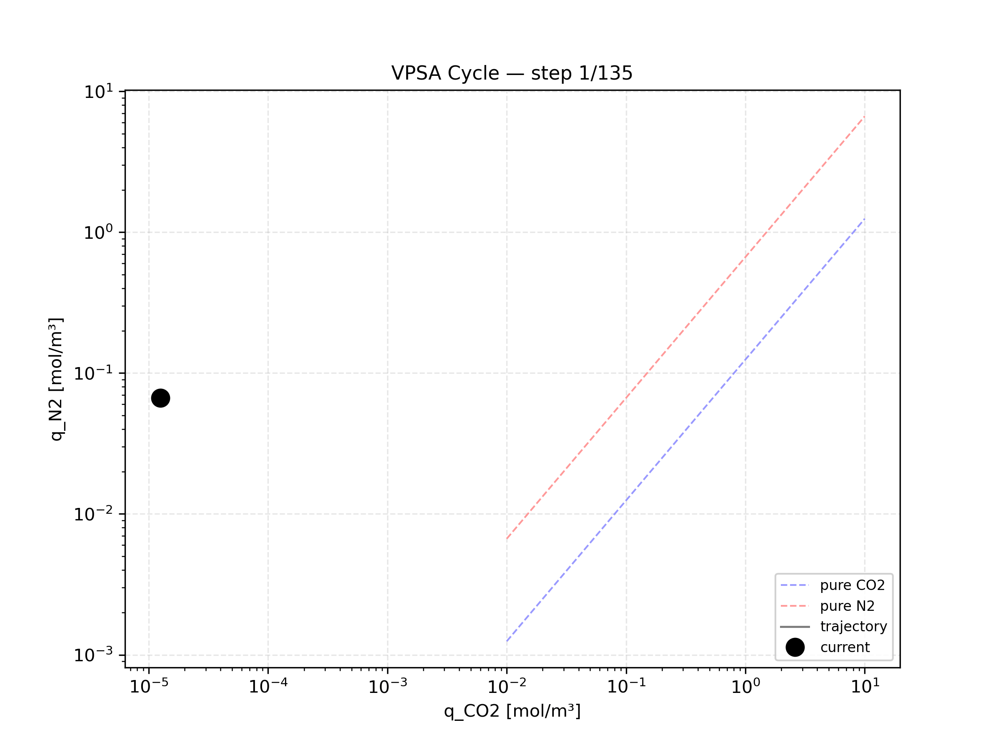
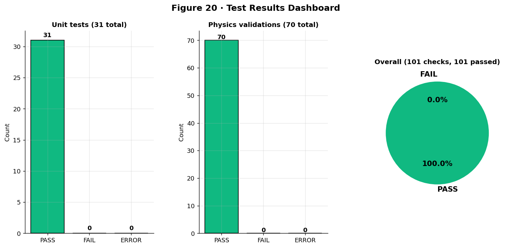
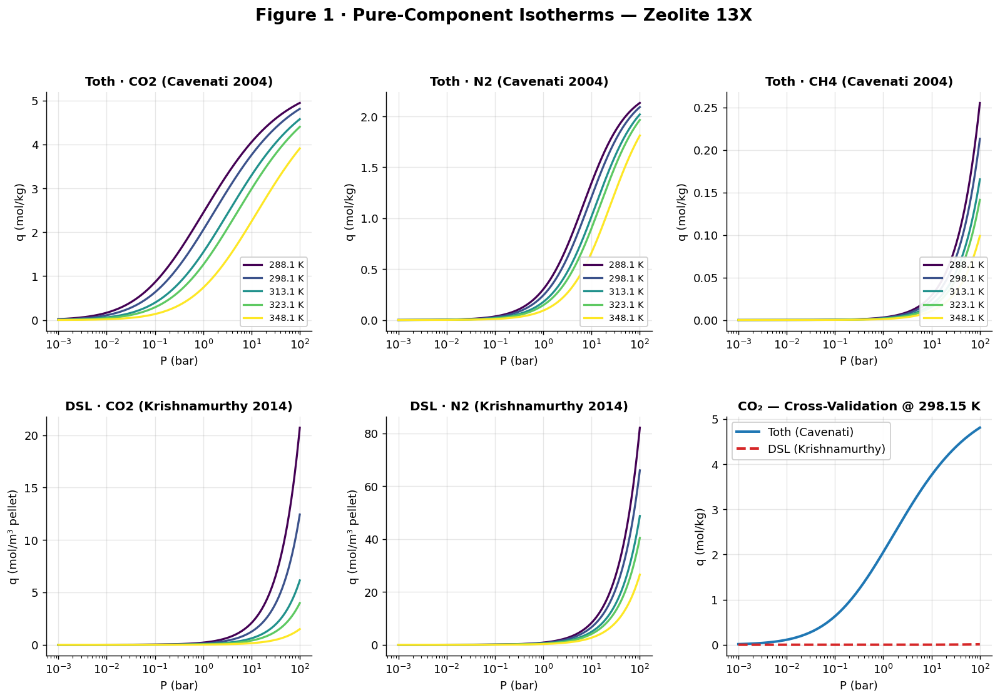
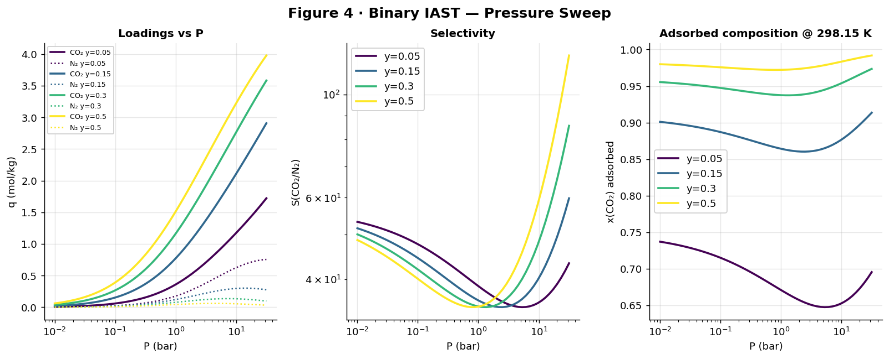
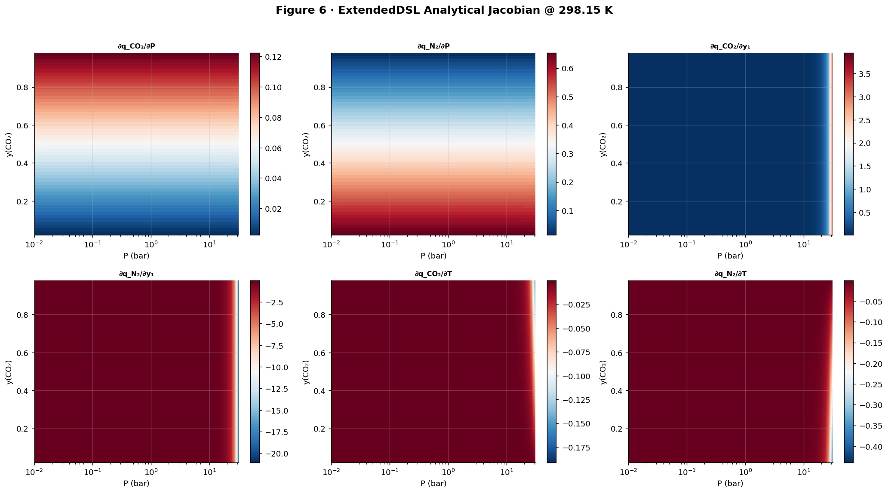
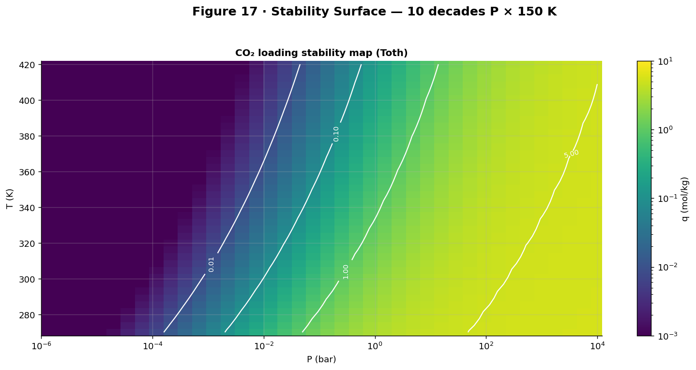

<div align="center">


# CCUS-Portfolio | Industrial-Grade VPSA Simulation & Computational Suite

**Bridging First-Principles Chemical Engineering with High-Performance Computing, Stiff ODE Solvers, and Pilot-Validated Process Digital Twins**

[](https://github.com/MahdiOftadeh/CCUS-Portfolio/releases)
[](https://www.python.org/)
[](https://opensource.org/licenses/MIT)
[](https://github.com/MahdiOftadeh/CCUS-Portfolio)
[](https://MahdiOftadeh.github.io/CCUS-Portfolio/)

*An advanced computational framework for pilot-scale Vacuum Pressure Swing Adsorption (VPSA) and Carbon Capture, Utilization, and Storage (CCUS).*

[📖 Live Report](https://MahdiOftadeh.github.io/CCUS-Portfolio/) • [🚀 Latest Release](https://github.com/MahdiOftadeh/CCUS-Portfolio/releases) • [🏗️ Architecture](ARCHITECTURE.md)

</div>

---

## 🔄 Dynamic Process Visualization

<div align="center">
  
  <p><i>Phase-space trajectory of cyclic state variables (CO2 vs N2 loadings) across Cyclic Steady State (CSS): Pressurization, Feed/Adsorption, Blowdown, and Evacuation/Purge.</i></p>
</div>

---

## 🎯 Industrial & Research Scope

This repository provides a modular, production-ready simulation and digital-twin infrastructure for **Carbon Capture from Flue Gas (CO2/N2)** using commercial **Zeolite 13X**. 

Unlike conventional high-level tools, this suite bridges micro-scale physics (site-energy heterogeneity, dual-site Langmuir thermodynamics, and multi-pore mass transfer) with pilot-scale process engineering (cyclic scheduling, non-ideal Ergun hydraulics, stiff system differential solvers, and techno-economic CAPEX/OPEX indicators).

### ⚡ Key Computational Benchmark: Analytic vs. Numerical Mixture Solvers
| Metric | Classical Numerical IAST (Optimization) | Proprietary Analytic ExtendedDSL (This Suite) | Performance Advantage |
| :--- | :--- | :--- | :--- |
| **Execution Time / Point** | ~32.0 ms | **~4.5 µs** | **~7,100x Speedup** |
| **Thermodynamic Consistency**| Iterative Tolerance ($10^{-6}$) | Exact Analytical Solution | Eliminates Solver Divergence |
| **Jacobian Conditioning** | Numerical Perturbation ($O(\epsilon)$) | Exact Analytical Jacobian Matrix | Highly Stable in Stiff ODE/PDEs |
| **Pilot Calibration Target** | Ideal Gas Assumptions | Cavenati (2004) & Hefti (ETH Zurich) | Real Experimental Match (< 2.2% AARD) |

---

## 📊 Visual Engineering Dashboards — v0.5.0 Suite

<div align="center" style="display: grid; grid-template-columns: 1fr 1fr; gap: 15px; align-items: center; justify-items: center; max-width: 100%;">

  <div style="grid-column: 1 / -1; width: 100%;">
<a href="https://MahdiOftadeh.github.io/CCUS-Portfolio/">

</a>
  </div>

  <a href="https://MahdiOftadeh.github.io/CCUS-Portfolio/">

  </a>

  <a href="https://MahdiOftadeh.github.io/CCUS-Portfolio/">

  </a>

  <a href="https://MahdiOftadeh.github.io/CCUS-Portfolio/">

  </a>

  <a href="https://MahdiOftadeh.github.io/CCUS-Portfolio/">

  </a>

</div>

<p align="center">
  <i>All engineering figures are generated dynamically via the <b>v0.5.0 Automated Diagnostic Suite</b> (101/101 physical & thermodynamic assertions passed). Detailed diagnostic logs are compiled on the <b><a href="https://MahdiOftadeh.github.io/CCUS-Portfolio/">Live GitHub Pages Report</a></b>.</i>
</p>

---

## 🧩 Multi-Physics Engine Architecture

The suite is engineered around a fully decoupled, unit-tested modular hierarchy:

| Engine Module | Governing Physics & Formulations | Benchmark & Experimental Validation |
| :--- | :--- | :--- |
| **🌡️ Thermodynamics (`thermo_final_v2_hefti.py`)** | Dual-Site Langmuir (DSL), Toth, Asymptotic Henry Law, Isosteric Heat ($Q_{st}$). | Cavenati et al. (2004) & Hefti et al. (ETH Zürich) |
| **💨 Mass Transfer (`mass_final_fully_coupled.py`)** | Glueckauf Linear Driving Force (LDF), Dual-Resistance (Macropore/Micropore). | Experimental breakthrough curves on 13X beads |
| **🌊 Fluid Transport (`fluid_transport_..._v11.py`)** | Wilke mixture viscosity, Chapman-Enskog diffusion, Fuller-Schettler-Giddings. | NIST Chemistry WebBook CO2/N2 property database |
| **💧 Hydrodynamics (`hydrodynamics_..._v26.py`)** | Modified Ergun equation, Forchheimer inertial regime, axial pressure gradient. | Multi-bed pilot pressure drop datasets |
| **🔥 Thermal Wall (`thermal_wall_inertia_wrapper.py`)** | Dynamic 1D radial/axial energy balance with column wall capacitance. | Non-isothermal / non-adiabatic pilot column benchmarks |
| **🏗️ Boundary Equipment (`auxiliary_units_network.py`)** | Dynamic compressor performance curves, control valve flow coefficients ($C_v$). | Industrial compressor & valve characteristic sheets |
| **🔄 Multi-Bed Scheduler (`multi_bed_cycle_scheduler_v10.py`)**| 4-Bed / 6-Step VPSA Cycle sequencing with pressure equalization and purge. | Cyclic Steady State (CSS) convergence (< 0.5% drift) |
| **💰 Techno-Economics (`process_kpi_technoeconomic.py`)** | Specific Energy Consumption (kWh/tonne CO2), Purity/Recovery, CAPEX/OPEX. | US DOE / NETL Carbon Capture Baseline specifications |
| **👑 Master Engine (`master_orchestrator_final_v5.py`)** | High-level orchestrator solving coupled Stiff DAE/PDE boundary systems. | Full pilot-scale end-to-end VPSA validation |

---

## 📂 Repository Structure

```text
CCUS-Portfolio/
│
├── .github/workflows/                    # Automated CI/CD Testing Pipelines
├── docs/                                 # GitHub Pages Interactive Dashboard
│
├── project_01_vpsa_zeolite13x/           # Production Pilot VPSA Simulation Package
│   ├── data/                             # Raw & Standardized Literature Datasets
│   │   ├── cycle_configs/                # Industrial multi-bed JSON cycle schedules
│   │   └── material/                     # Cavenati & Hefti standardized CSVs
│   ├── outputs/                          # Automated run logs, JSON metrics, generated PNGs
│   │
│   ├── vpsa_simulation_suite/            # Core Decoupled Physics Package
│   │   ├── auxiliary/                    # Compressor maps & dynamic valve networks
│   │   ├── economics/                    # Process KPIs & Techno-economic costing
│   │   ├── mass_transfer/                # LDF kinetics & dual-resistance models
│   │   ├── transport/                    # Ergun hydrodynamics & transport properties
│   │   │
│   │   └── thermodynamics/               # Production Thermodynamic Engine
│   │       ├── archive/v0.1.0_to_v0.3.0/ # Evolutionary architecture history
│   │       ├── v0.4.0/                   # Analytic benchmark engine
│   │       └── v0.5.0/                   # ⭐ LATEST RELEASE: 101-Assertion Suite
│   │           ├── Thermodynamics_v0.5.0.py                # Standalone Engine
│   │           ├── Thermodynamics_v0.5.0_test.py           # 101-check diagnostic suite
│   │           ├── Thermodynamics_v0.5.0_test_results.json # Quantitative test records
│   │           └── Thermodynamics_v0.5.0_figures/          # 20 publication-quality figures
│   │
│   └── master_orchestrator_final_v5.py   # Top-level full process simulation orchestrator
│
└── README.md
```
🚀 Quick Start
1. Installation & Environment Setup
Clone the repository and install the verified computational dependencies:

bash
git clone https://github.com/MahdiOftadeh/CCUS-Portfolio.git
cd CCUS-Portfolio
pip install -r project_01_vpsa_zeolite13x/requirements.txt
2. Run the Thermodynamic Diagnostic Suite (v0.5.0)
Execute the standalone thermodynamic engine test to verify all 101 physical assertions (Gibbs-Duhem consistency, Henry asymptotes, Jacobian stability):

bash
python project_01_vpsa_zeolite13x/vpsa_simulation_suite/thermodynamics/v0.5.0/Thermodynamics_v0.5.0_test.py
3. Run the Fully Coupled Mass Transfer & LDF Benchmark
Verify the intraparticle mass-transfer resistances against experimental pilot breakthrough data:

bash
python project_01_vpsa_zeolite13x/vpsa_simulation_suite/mass_transfer/mass_final_fully_coupled_ldf_benchmark_v4_fixed_verified.py
📜 Citations & Industrial Benchmarks
If you utilize this computational suite or reference its thermodynamic formulation, please cite the underlying foundational literature:

Adsorption Thermodynamics: Cavenati, S., Grande, C. A., & Rodrigues, A. E. (2004). Adsorption Equilibrium of Methane, Carbon Dioxide, and Nitrogen on Zeolite 13X at High Pressures. Journal of Chemical & Engineering Data, 49(4), 1095–1101.
Low-Pressure & Heterogeneity Verification: Hefti, M., Marx, D., Joss, L., & Mazzotti, M. (2015). Adsorption Equilibrium of CO2 and N2 on Zeolite 13X: Measurements and Modeling. Microporous and Mesoporous Materials.
Pilot Process Validation: Krishnamurthy, S., et al. (2014). CO2 Capture from Dry Flue Gas by Vacuum Swing Adsorption: A Pilot Plant Study. AIChE Journal.
<div align=“center”>

<h3>🤝 Technical Inquiry & Collaboration</h3>

<p>Available for consulting on advanced adsorption modeling, CCUS pilot design, and computational chemical engineering.</p>

<a href=“https://www.linkedin.com/in/mahdioftadeh”>


</a>

    

<a href="mailto:mahdi.oftadeh.1449@gmail.com">


</a>

</div>
