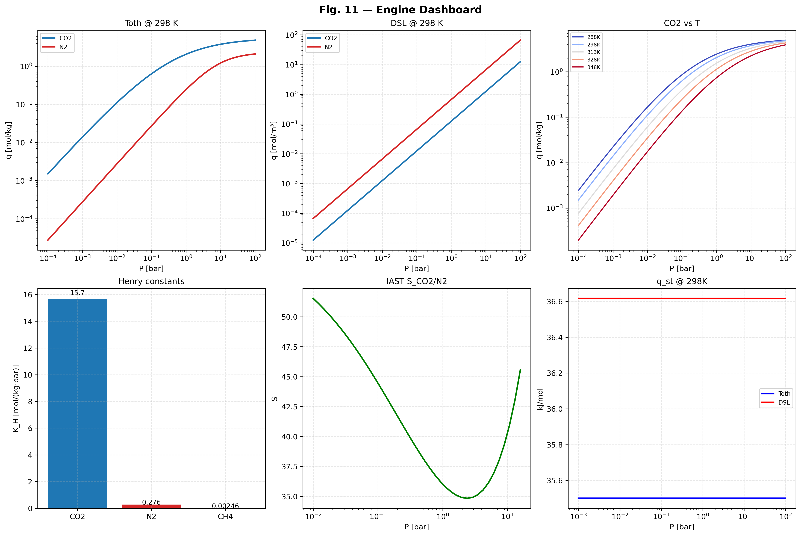
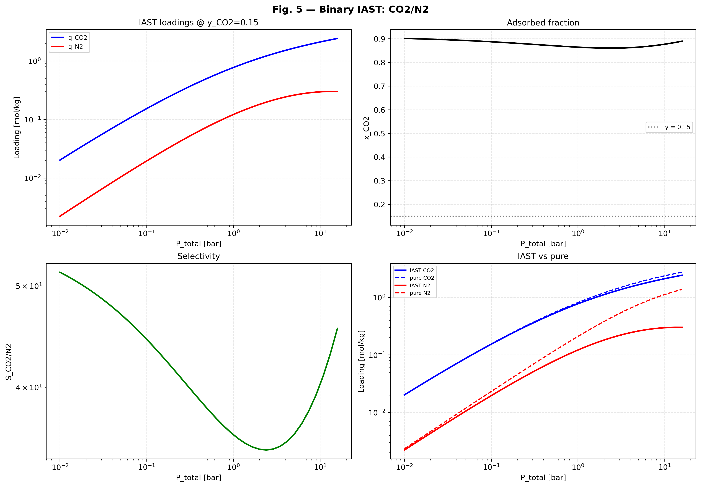
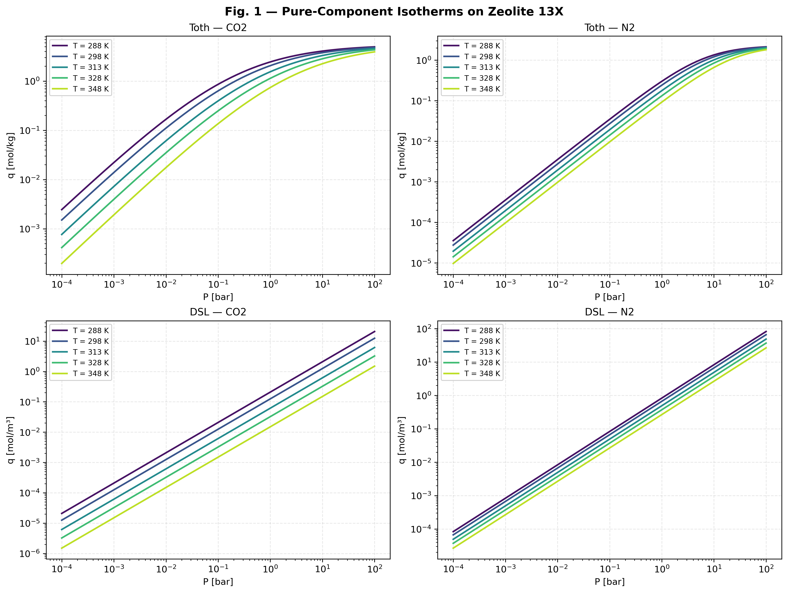
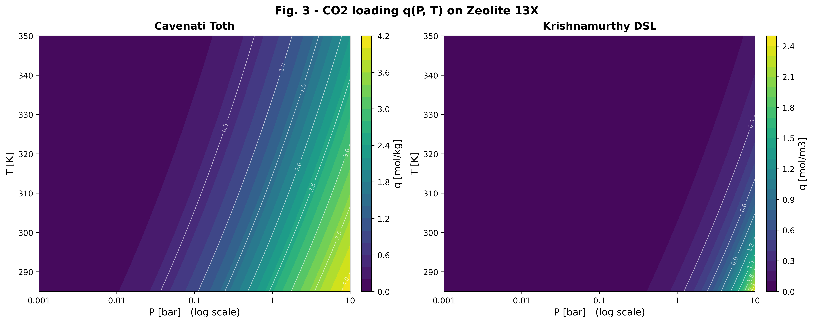

<div align="center">


# CCUS-Portfolio | Computational Research & VPSA Simulation

**Bridging Classical Chemical Engineering with Physics-Informed ML , LLM , AI , and Advanced Optimization**

[](https://github.com/MahdiOftadeh/CCUS-Portfolio/releases)
[](https://www.python.org/)
[](https://opensource.org/licenses/MIT)
[](https://MahdiOftadeh.github.io/CCUS-Portfolio/)

*A computational research portfolio focused on Carbon Capture, Utilization, and Storage (CCUS) optimization.*

[📖 Live Report](https://MahdiOftadeh.github.io/CCUS-Portfolio/) • [🚀 Latest Release](https://github.com/MahdiOftadeh/CCUS-Portfolio/releases) • [🏗️ Architecture](ARCHITECTURE.md)

</div>

---

## 🔄 Dynamic Process Visualization

<div align="center">
  
  <p><i>Live simulation of the VPSA cycle trajectory (CO2 vs N2 loadings) moving through adsorption, blowdown, and purge steps.</i></p>
</div>

---

## 🎯 Research Vision

This repository serves as a centralized hub for advanced computational research in CCUS. The goal is to bridge the gap between classical chemical engineering principles and cutting-edge data-driven methodologies—including **Artificial Intelligence (AI)**, **Large Language Models (LLM)**, **Physics-Informed Machine Learning (PIML)**, and **Bayesian Optimization**—to accelerate the transition to sustainable energy systems.

---

## 📊 Visual Showcase

<div align="center" style="display: grid; grid-template-columns: 1fr 1fr; gap: 15px; align-items: center; justify-items: center; max-width: 100%;">
  <a href="https://MahdiOftadeh.github.io/CCUS-Portfolio/"></a>
  <a href="https://MahdiOftadeh.github.io/CCUS-Portfolio/"></a>
  <a href="https://MahdiOftadeh.github.io/CCUS-Portfolio/"></a>
  <a href="https://MahdiOftadeh.github.io/CCUS-Portfolio/"></a>
</div>

<p align="center">
  <i>All figures are generated automatically by the v0.4.0 validation suite and hosted on the <b><a href="https://MahdiOftadeh.github.io/CCUS-Portfolio/">Live Report</a></b>.</i>
</p>

---

## 🧠 Core Methodologies & AI Integration

*   **AI & LLM-Assisted Research**: The `llm/` module utilizes Large Language Models and AI agents to automate literature review, data extraction, and research summarization.
*   **Physics-Informed Machine Learning (PIML)**: Integrating thermodynamic and transport constraints directly into neural network architectures.
*   **Surrogate Modeling**: Developing high-fidelity, low-cost computational models to replace expensive mechanistic simulations.
*   **Bayesian Optimization**: Navigating complex, high-dimensional design spaces for optimal process configuration.

---

## 🧩 Comprehensive Engine Architecture

The VPSA simulation suite is a modular, multi-physics platform. Every engine is rigorously validated against literature benchmarks and experimental datasets.

| Engine Module | Description |
| :--- | :--- |
| **🌡️ Thermodynamics** | Analytic models (Toth, DSL, IAST) for mixture equilibrium and isosteric heat. |
| **💨 Mass Transfer** | Linear Driving Force (LDF) kinetics and breakthrough curve modeling. |
| **🌊 Fluid Transport** | Gas-phase transport properties, viscosity, and mass diffusivity. |
| **💧 Hydrodynamics** | Pressure drop, Ergun equation, and flow distribution across the bed. |
| **🔥 Thermal Wall** | Heat transfer coefficients, wall thermal mass, and energy balances. |
| **🏗️ Equipment & Boundary Network** | Compressor maps, valves, and piping network integration. |
| **🏛️ Column Modeling** | 1D/2D spatial discretization for adsorption columns. |
| **🔄 Multi-Bed Cycle** | Complex Skarstrom and VPSA cycle scheduling (CSS, Pressurization, Blowdown). |
| **📉 Aging & Degradation** | Long-term adsorbent degradation and cyclic capacity loss. |
| **💰 Economics** | CAPEX/OPEX correlations, process KPIs, and cost-of-capture models. |
| **⚖️ Multi-Objective Optimization** | Pareto front generation, surrogate modeling, and DOE. |
| **🌐 Digital Twin** | Real-time data assimilation and dynamic process mirroring. |
| **👑 Master Engine** | Unified orchestrator coupling all physics, economics, and optimization loops. |

> **🚀 Latest Highlight (v0.4.0)**: The Thermodynamics engine was upgraded to a fully analytic framework. The `ExtendedDSL` model replaces the numerical IAST solver, yielding a **~7000x speedup** (~4.5 µs vs ~32 ms) while maintaining thermodynamic consistency.

---

## 📂 Repository Structure

```
CCUS-Portfolio/
│
├── .github/workflows/            # CI/CD pipelines (GitHub Actions)
├── docs/                         # GitHub Pages (Live Validation Report)
├── llm/                          # AI & LLM tools (e.g., paper summarizers)
│
├── project_01_vpsa_zeolite13x/   # Core VPSA CO2/N2 Separation Project
│   ├── data/                     # Material and cycle configuration data
│   │   ├── cycle_configs/        # VPSA cycle JSON configurations
│   │   └── material/             # Literature isotherms & LDF data (CSV/JSON)
│   ├── docs/                     # Theory and DOE targets
│   ├── outputs/                  # Generated datasets, figures, and tables
│   ├── scripts/                  # Execution & optimization scripts
│   │   ├── run_breakthrough.py
│   │   ├── run_vpsa_cycle.py
│   │   └── run_optimization.py
│   ├── tests/                    # Integration tests (isotherms, mass balance)
│   │
│   ├── vpsa_commercial_suite/    # Commercial-grade dashboards and reports
│   │   ├── figures/              # High-level UI dashboards
│   │   └── reports/
│   │
│   └── vpsa_simulation_suite/    # Core Python Package
│       ├── auxiliary/            # Compressor maps & units network
│       ├── benchmarks/           # Jupyter notebooks for validation
│       ├── economics/            # Techno-economic KPIs
│       ├── mass_transfer/        # LDF kinetics
│       ├── optimization/         # DOE, Pareto, Surrogates
│       ├── solvers/              # CSS, Breakthrough, Cycle solvers
│       ├── thermodynamics/       # 🌟 Thermodynamics Engine
│       │   ├── archive/v0.1.0/   # Historical versions
│       │   ├── v0.3.0/           # Legacy suite
│       │   └── v0.4.0/           # Latest Analytic Engine & 57-check tests
│       ├── transport/            # Hydrodynamics & kinetics
│       └── visualization/        # Plotting utilities
│
└── README.md
```
🚀 Quick Start
1. Requirements
Ensure you have Python 3.10+ installed.

bash
pip install -r project_01_vpsa_zeolite13x/requirements.txt
pip install numpy scipy matplotlib pillow
2. Run the Core Thermodynamic Validation (v0.4.0)
Independently verify the 57 physics checks and regenerate the 14 figures:

bash
python project_01_vpsa_zeolite13x/vpsa_simulation_suite/thermodynamics/v0.4.0/Thermodynamics_v0.4.0_test.py
3. Run the Full VPSA Simulation Tests
bash
cd project_01_vpsa_zeolite13x/vpsa_simulation_suite
python -m pytest tests/ -v
📜 License & Citation
This project is licensed under the MIT License - see the LICENSE file for details.

Copyright (c) 2026 Mahdi Oftadeh

If you use this thermodynamic engine or the VPSA simulation suite in your research, please cite the underlying literature:

Cavenati, S., Grande, C. A., & Rodrigues, A. E. (2004). Adsorption equilibrium of methane, carbon dioxide, and nitrogen on zeolite 13X at high pressures.

Krishnamurthy, S., et al. (2014). CO2 capture from dry flue gas by vacuum swing adsorption: A pilot plant study.

---

<div align="center">
  <h3>🤝 Let's Connect & Collaborate</h3>
  <p>Feel free to reach out for research collaborations, discussions on CCUS, or just to say hi!</p>

  <a href="https://www.linkedin.com/in/mahdioftadeh">
    
  </a>
  &nbsp;&nbsp;&nbsp;&nbsp;
  <a href="mailto:mahdi.oftadeh.1449@gmail.com">
    
  </a>
  
  <br><br>
  <i>Built with ❤️ for a greener planet and a decarbonized future.</i>
</div>
